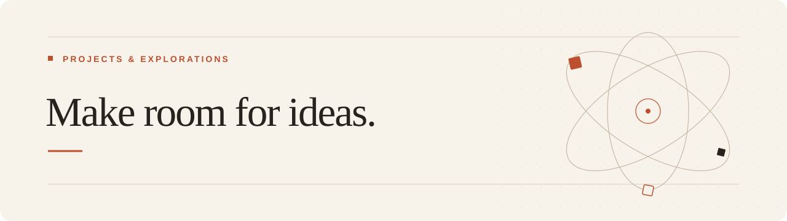

# 你好，我是 Shr1nz1

这里记录我的项目、实践与探索。

从一个想法开始，把尝试慢慢整理成作品，也留下过程中的思考。

[个人主页 ↗](https://shr1nz1.github.io/) · [全部仓库 ↗](https://github.com/Shr1nz1?tab=repositories)

## 项目

项目正在整理中，后续会逐步加入项目介绍、使用方法与相关资料。

完整项目目录收录在[个人主页](https://shr1nz1.github.io/#projects)，随公开项目持续更新。

<!--
上传项目后，在这里精选展示 2–4 个代表项目；完整项目列表可放在个人网站中。
每个项目建议写清：
1. 项目名称与真实仓库链接。
2. 它解决什么问题，或探索什么想法。
3. 如何使用，以及目前的进展。
不要保留示例项目、虚构成果或无效链接。
-->

## 这里会记录

- **项目与作品** · 从最初的想法，到可以使用的版本。
- **实践与笔记** · 尝试过的方法、遇到的问题，以及解决过程。
- **持续的探索** · 尚未完成的想法，以及下一步的尝试。

---

给想法留一点空间，让项目慢慢生长。
